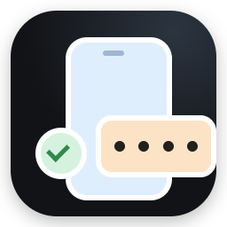
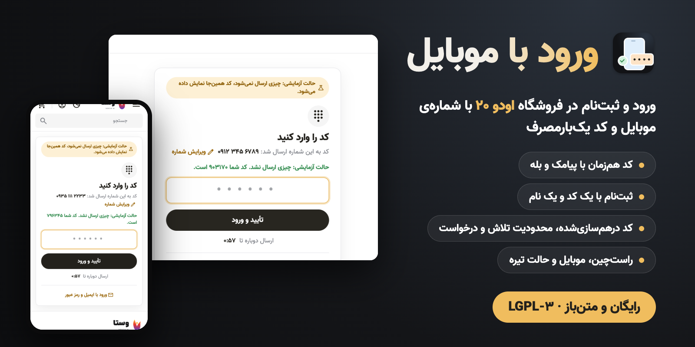

<p align="center">
  
</p>

<p align="center">
  <a href="https://github.com/vestaai-ir/vesta-auth-otp/releases/latest"></a>
  
  
  
</p>

<p align="center"><a href="#fa">فارسی</a> · <a href="#en">English</a></p>

<p align="center"></p>

---

<div dir="rtl" id="fa">

## ورود با موبایل وستا؛ ورود و ثبت‌نام در فروشگاه اودو ۲۰ با کد یک‌بارمصرف

**ورود با موبایل وستا** به مشتری‌ها اجازه می‌دهد با شماره‌ی موبایل و یک کد یک‌بارمصرف وارد وب‌سایت شوند یا ثبت‌نام کنند. کد **هم‌زمان** با پیامک (از راه **وستا مارکتینگ** و sms.ir) و در **بله** (سرویس سفیر) ارسال می‌شود و صفحه می‌گوید کد به کجا رفت.

- 📱 **کارت دومرحله‌ای**: شماره‌ی موبایل، سپس کد، با شمارش معکوس «ارسال دوباره تا ۰:۵۹» و «ویرایش شماره». ورود با ایمیل و رمز عبور یک کلیک فاصله دارد.
- 🆕 **ثبت‌نام با یک کد**: شماره‌ی تازه فقط «نام و نام خانوادگی» می‌خواهد و کاربر پرتال ساخته می‌شود.
- 🔐 **ورود استاندارد اودو**: نشست با ورود خود اودو باز می‌شود (نوع اعتبار `vesta_otp`)؛ ورود دومرحله‌ای (TOTP) همچنان اعمال می‌شود و تسویه‌حساب پس از ورود برمی‌گردد.
- 🛡️ **امن**: کد ۴ تا ۶ رقمی با `secrets`، فقط HMAC آن ذخیره می‌شود، ۱۲۰ ثانیه اعتبار، باطل پس از ۵ تلاش نادرست، محدودیت برای هر شماره و هر IP، و پاسخ‌هایی که وجود حساب را لو نمی‌دهند.
- ⚡ **ارسال سریع sms.ir** با شناسه‌ی قالب، یا پیامک فوری اودو؛ خط `@domain #code` و `autocomplete="one-time-code"` برای پر شدن خودکار کد در گوشی.
- 👤 **حساب من**: موبایل تأییدشده در `/my/account`؛ تغییر شماره فقط با کد شماره‌ی تازه.
- 🧪 **حالت آزمایشی** (پیش‌فرض روشن): چیزی ارسال نمی‌شود و کد روی صفحه نمایش داده می‌شود.
- ♿ راست‌چین، ارقام فارسی، عرض گوشی و حالت تیره‌ی **فروشگاه وستا**.

### نصب

```bash
cd /opt/odoo/custom-addons
git clone -b 20.0 https://github.com/vestaai-ir/vesta-marketing.git
git clone -b 20.0 https://github.com/vestaai-ir/vesta-auth-otp.git
odoo -c /etc/odoo/odoo.conf -d YOUR_DB -i vesta_auth_otp --stop-after-init
```

به **وستا مارکتینگ** (`vesta_marketing`، پیامک sms.ir) نیاز دارد. سپس در *وب‌سایت ← پیکربندی ← تنظیمات ← ورود با موبایل* آن را روشن کنید، کلید sms.ir و کلید و شناسه‌ی بات سفیر بله را وارد کنید و حالت آزمایشی را خاموش کنید.

[وستا](https://vestaai.ir) · [info@vestaai.ir](mailto:info@vestaai.ir)

</div>

---

<div id="en">

## Vesta Mobile Login: log in and sign up on Odoo 20 with a one-time code

**Vesta Mobile Login** lets customers log in and sign up on the website with their mobile number and a one-time code. The code goes out **at the same time** by SMS (through **Vesta Marketing** and sms.ir) and on **Bale** (its Safir code service); the page says where it went.

- 📱 **Two-step card**: the mobile number, then the code, with a resend countdown and «Edit number». The email and password login stays one click away.
- 🆕 **Sign-up with one code**: a new number only asks for the full name and gets a portal user.
- 🔐 **Odoo's own login**: the session is opened by Odoo (a credential of type `vesta_otp`), so two-factor authentication (TOTP) still applies and the checkout comes back after the login.
- 🛡️ **Safe**: 4 to 6 digit codes from `secrets`, stored only as an HMAC, valid 120 seconds, dead after 5 wrong attempts, limits per number and per IP address, answers that never tell whether an account exists.
- ⚡ **sms.ir fast send** with a template id, or an immediate Odoo SMS; the `@domain #code` line and `autocomplete="one-time-code"` let phones fill the code in.
- 👤 **My account**: the verified mobile on `/my/account`; a new number needs a code first.
- 🧪 **Test mode** (on by default): nothing is sent, the code is shown on the page.
- ♿ RTL first, Persian digits, phone width and the dark theme of **Vesta Shop**.

### Install

```bash
cd /opt/odoo/custom-addons
git clone -b 20.0 https://github.com/vestaai-ir/vesta-marketing.git
git clone -b 20.0 https://github.com/vestaai-ir/vesta-auth-otp.git
odoo -c /etc/odoo/odoo.conf -d YOUR_DB -i vesta_auth_otp --stop-after-init
```

Depends on **Vesta Marketing** (`vesta_marketing`, SMS through sms.ir). Then in *Website > Configuration > Settings > Login with Mobile* turn it on, enter the sms.ir key (Vesta Marketing settings), the Safir key and bot id of Bale (https://business.bale.ai), and turn test mode off.

### Translations

`vesta_auth_otp/i18n/fa.po` is built by `vesta_auth_otp/tools/fa_terms.py` from the template exported by Odoo. After changing the module:

```bash
odoo i18n export -d YOUR_DB vesta_auth_otp
python3 vesta_auth_otp/tools/fa_terms.py
```

### Release

```bash
python3 tools/vesta_release.py vesta_auth_otp --out dist
```

[Vesta AI](https://vestaai.ir) · [info@vestaai.ir](mailto:info@vestaai.ir)

</div>
